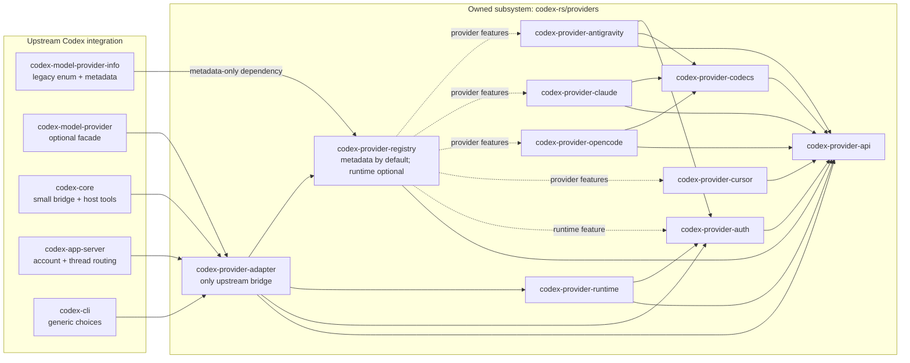

# Native provider refactor architecture

Provider protocol implementations, codecs, credentials, registry, and session
runtime live under [`codex-rs/providers/`](../../codex-rs/providers/). This
subtree is the native-provider subsystem. Its packages can depend on one
another, but cannot depend on `codex-core` or other upstream integration crates.
`codex-provider-adapter` is the only package that crosses that boundary. The
[integration manifest](integration-manifest.json) records the owned packages,
feature gates, focused regression groups, and upstream hooks that must remain.

## Dependency boundary

The registry has two deliberately separate roles. Its default build exposes
provider descriptors only and depends on the neutral provider API. The
`runtime` feature adds transport/runtime dependencies, and each
`provider-*` feature selects one implementation. This lets
`codex-model-provider-info` expose provider metadata and legacy wire aliases
without pulling in provider transports. The adapter enables registry runtime
support and translates between provider-neutral calls and upstream Codex types.

The arrows into the adapter are the integration seam. No arrow points from the
owned subsystem back to `codex-core`; the architecture check evaluates the
Cargo workspace dependency graph and enforces that restriction, including for
optional and target-specific dependencies. It also scans production Rust in
the core, CLI, app-server request processors, model-provider facade, and TUI
for provider-ID execution branches. The legacy enum and generated/config proto
paths are recorded as compatibility surfaces in the checker manifest.

## Completion and persistence order

The provider API keeps tool completion separate from provider output. A host
completion contains a call ID, ordinary output, optional structured execution
data, and a `Success`, `Failure`, or `Denied` disposition. Core records the
actual truncated model-visible result through its existing history path before
returning the typed completion. The adapter matches that completion to the
pending call and preserves structured data independently.

For tools that execute host operations, runtime ordering is:

1. Persist the interrupted-execution fence before dispatching any host action.
2. Journal the call before running it; replay a stored result for a repeated
   call ID instead of executing it twice.
3. Dispatch through Codex's normal tool path and wait for its recorded result
   and typed completion. For shell operations, collect any `write_stdin`
   continuations and the final structured process result.
4. Persist the resulting tool journal entry before returning the result to the
   provider session.
5. On terminal turn completion, bind the checkpoint to the verified history
   prefix, clear the pending marker, persist it, and release the execution
   lease.

Failure and denial remain explicit dispositions. The host history output does
not need to encode execution metadata in a provider-shaped JSON object. An
interrupted operation leaves a durable fence so a restart cannot silently
repeat side effects; recovery either restores the previous checkpoint or
rebuilds from verified history according to the declared policy.

## Durable compatibility

The compatibility snapshots in
[`provider-runtime/tests/fixtures/compatibility-v1/`](../../codex-rs/providers/provider-runtime/tests/fixtures/compatibility-v1/)
were captured from the published implementation at
`29413a496e28042629125693b3d8c218e49be879`. They use synthetic, invalid token
and signature values. The fixture tests assert that the refactored stores read
those credential/account, checkpoint, tool-journal, and execution snapshots;
write the same durable bytes; preserve stable lock filenames; and retain the
provider namespace hashes for Cursor, OpenCode Go, Claude, and Antigravity.
`identities.json` records the expected hashes. The suite also freezes the
checkpoint host-lineage/signature shape and interrupted execution marker.

This is a serialization/identity compatibility contract. A fixture passing
does not by itself establish live-provider behavior or validate a real
credential. See the [fixture test](../../codex-rs/providers/provider-runtime/tests/compatibility_fixtures.rs)
and its [sanitized fixture notes](../../codex-rs/providers/provider-runtime/tests/fixtures/compatibility-v1/README.md).

## Retained upstream hooks

The links below are the required integration hooks; each has a focused test
group in the [integration manifest](integration-manifest.json).

- [`model-provider-info`](../../codex-rs/model-provider-info/src/lib.rs) keeps
  legacy enum aliases for wire compatibility while registry descriptors supply
  generic metadata.
- [Remote thread configuration](../../codex-rs/config/src/thread_config/remote.rs)
  carries a generic provider identity and model through the existing config
  path.
- The [model-provider facade](../../codex-rs/model-provider/src/native.rs)
  exposes the adapter as an optional backend.
- The [core bridge](../../codex-rs/core/src/native_provider.rs) stays small;
  [client construction and stream routing](../../codex-rs/core/src/client.rs)
  use the adapter, while [`SessionControl`](../../codex-rs/core/src/client_common.rs)
  owns lifecycle and cancellation.
- [Turn handling](../../codex-rs/core/src/session/turn.rs) records completion,
  retry, and terminal outcomes. [Parallel tool dispatch](../../codex-rs/core/src/tools/parallel.rs)
  captures structured results before adapter resubmission, and
  [thread-scoped model metadata](../../codex-rs/core/src/thread_manager.rs)
  stays scoped to its thread.
- [App-server account operations](../../codex-rs/app-server/src/request_processors/account_processor.rs)
  use generic adapter dispatch and explicit ownership locking;
  [thread processing](../../codex-rs/app-server/src/request_processors/thread_processor.rs)
  preserves inherited provider identity on fork and cold resume when there is
  no override.
- [CLI provider choices](../../codex-rs/cli/src/provider_cmd.rs) come from
  generic provider metadata.

## Validation automation

[`scripts/native_provider_architecture.py`](../../scripts/native_provider_architecture.py)
checks the owned package manifest against Cargo metadata, validates the
dependency boundary, confirms registry descriptor IDs and integration-hook
coverage, and scans maintained production source roots for provider-specific
branches. Its Python tests include negative controls for forbidden dependency
edges and new execution branches.

The [native-provider workflow](../../.github/workflows/native-providers.yml)
runs the focused validation script on hosted Linux. The script records stage
logs, test counts, commit IDs, and hashes for artifacts. The separate daily and
manual upstream merge probe reports source and generated-file conflicts
without resolving them or pushing changes. GitHub schedules workflows only
from the repository's default branch, so the daily schedule starts only after
this workflow is on `main`. A clean merge probe reports mergeability; it does
not replace normal tests or generated-artifact review.
